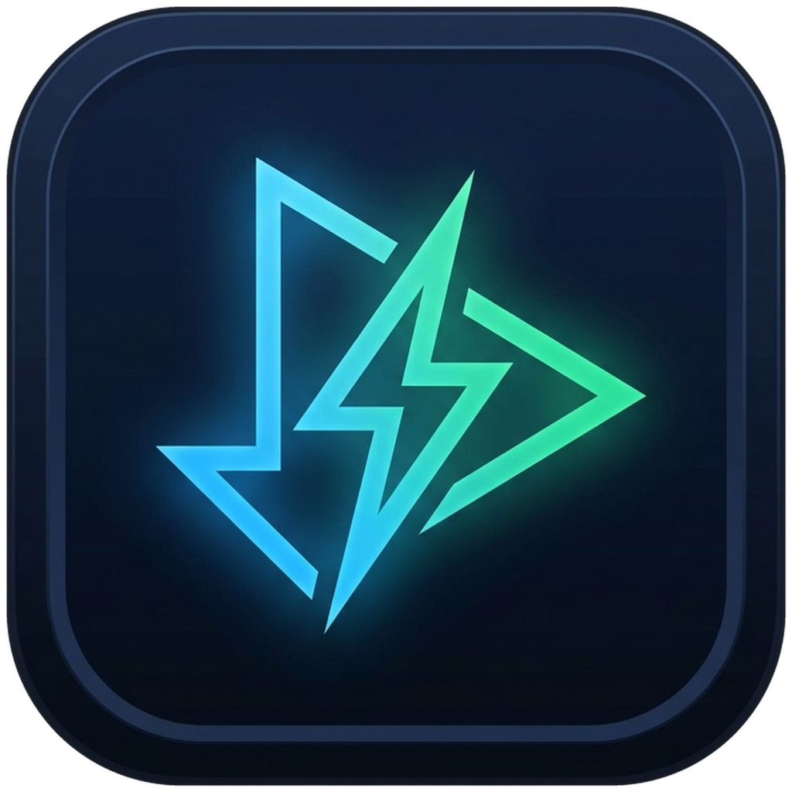

<p align="center">
  
</p>

<h1 align="center">SwiftGrab</h1>

<p align="center">
  <strong>Aplikasi Pengunduh Video & Audio Android Cepat, Bebas Iklan, dan Open-Source</strong><br />
  Bertenaga <code>yt-dlp</code>, <code>aria2c</code>, dan <code>FFmpeg</code> dengan pengalaman <em>Zero-Paste & One-Tap Download</em>.
</p>

<p align="center">
  <a href="https://github.com/madhasoeki/SwiftGrab/actions/workflows/android-ci.yml">
    
  </a>
  <a href="https://github.com/madhasoeki/SwiftGrab/actions/workflows/release-apk.yml">
    
  </a>
  <a href="https://github.com/madhasoeki/SwiftGrab/releases/latest">
    
  </a>
  <a href="https://www.gnu.org/licenses/gpl-3.0">
    
  </a>
  <a href="https://developer.android.com">
    
  </a>
  <a href="https://github.com/madhasoeki/SwiftGrab">
    
  </a>
  <a href="https://github.com/madhasoeki/SwiftGrab">
    
  </a>
</p>

---

## 📖 Tentang SwiftGrab

**SwiftGrab** adalah aplikasi Android pengunduh media (*video/audio*) modern yang dirancang untuk mengatasi kerumitan aplikasi sejenis: tanpa iklan mengganggu, tanpa pelacak analitik pihak ketiga, dan tanpa browser internal yang lambat.

Dibangun menggunakan **Jetpack Compose** dan **Material Design 3 (M3)**, SwiftGrab mengutamakan filosofi **Zero-Friction**: pengguna dapat mengunduh video cukup dalam **1 ketukan** langsung dari menu *Share* aplikasi lain (YouTube, TikTok, Instagram, X/Twitter, Reddit, dsb.) atau secara otomatis dari papan klip (*clipboard*).

---

## ✨ Fitur Utama

* ⚡ **Pemicu Unduh Instan (Zero-Paste Triggers):**
  * **1-Tap Share Sheet:** Bagikan tautan dari aplikasi mana saja ke SwiftGrab; unduhan langsung berjalan di latar belakang tanpa mengganggu aktivitas Anda.
  * **Quick Format Sheet Mode:** Opsional, tampilkan *bottom sheet* mengambang untuk memilih preset video atau audio sebelum mengunduh.
  * **Deteksi Clipboard Otomatis:** Saat membuka aplikasi, SwiftGrab mendeteksi tautan di papan klip secara aman dan menawarkan unduh video/audio langsung.
  * **Quick Settings Tile:** Tambahkan ubin *"Unduh dari Klip"* di panel notifikasi Android untuk memicu unduhan instan dari mana saja.
* 🚀 **Mesin Unduh Berkekuatan Tinggi:**
  * Didukung oleh [yt-dlp](https://github.com/yt-dlp/yt-dlp) untuk kompatibilitas lebih dari 1.000 situs web.
  * Akselerasi koneksi multi-segmen berkecepatan tinggi via modul C++ [aria2c](https://github.com/aria2/aria2).
  * Penggabungan otomatis audio & video resolusi tinggi (1080p, 2K, 4K) dan ekstraksi MP3/M4A via biner native [FFmpeg](https://ffmpeg.org/).
* ⏸ **Jeda & Lanjutkan (Pause & Resume) Sejati:**
  * Pengendalian proses atomic berbasis `taskId` unik. Jeda unduhan kapan saja dan lanjutkan dari posisi byte terakhir tanpa mengulang dari 0% berkat flag `--continue` dan `.aria2`.
* 📲 **Dukungan Latar Belakang Android 14 & 15:**
  * Mematuhi regulasi `foregroundServiceType="dataSync"` Android 14+ dan batas waktu (*timeout handling*) Android 15.
  * Notifikasi interaktif dengan tombol **Jeda**, **Lanjutkan**, dan **Batal** langsung dari *notification drawer*.
* 🔐 **Pengelola Akun & Cookies X (Twitter):**
  * Fitur login WebView resmi ke `x.com` untuk mengekstrak dan menyimpan *session cookies* ke penyimpanan privat lokal, memungkinkan unduhan video berlabel konten sensitif atau dibatasi usia 18+.
* 🔄 **Pembaruan Ekstraktor yt-dlp Mandiri:**
  * Perbarui biner `yt-dlp` langsung dari menu Pengaturan aplikasi tanpa perlu menunggu atau menginstal pembaruan APK baru.
* 🎨 **Desain Elegan & Bersih:**
  * Tema gelap kontras tinggi (*Deep Cobalt & Emerald Accent*), *Edge-to-Edge* penuh, angka kecepatan tabular monospasi (anti-kedip), dan target sentuh aksesibel.

---

## 🏛 Tabel Arsitektur Aplikasi

SwiftGrab mengadopsi pola arsitektur **Clean Architecture + Unidirectional Data Flow (UDF)** yang kokoh:

| Lapisan (Layer) | Modul & Paket | Teknologi Utama | Peran & Tanggung Jawab |
| :--- | :--- | :--- | :--- |
| **UI Layer** | `com.example.swiftgrab.ui` | Jetpack Compose, Material 3, ViewModel | Merender antarmuka stateless (`MainScreen`, `ShareInterceptActivity`), mengelola state UI via `StateFlow`, dan menangkap event interaksi. |
| **Service Layer** | `com.example.swiftgrab.service` | Android Foreground Service (`dataSync`), BroadcastReceiver, TileService | Menjalankan unduhan di thread latar belakang, mengelola siklus hidup proses biner, dan menampilkan notifikasi persentase real-time. |
| **Data / Storage** | `com.example.swiftgrab.data.db`<br/>`com.example.swiftgrab.data.prefs` | Room Database (SQLite), SharedPreferences | Menyimpan entitas tugas (`DownloadTaskEntity`), riwayat unduhan, argumen ekstraktor, dan preferensi pengguna. |
| **Repository** | `com.example.swiftgrab.data.repository` | Kotlin Coroutines `Flow` | Menjadi *Single Source of Truth* (SSOT) yang mengoordinasikan operasi database dengan UI dan Service. |
| **Native Core** | `youtubedl-android`, `ffmpeg`, `aria2c` | C/C++ JNI, Python, ProcessBuilder | Ekstraksi metadata media, pengunduhan aliran byte multi-segmen, dan *muxing* audio/video. |

---

## 📥 Panduan Instalasi

### 1. Unduh Langsung via GitHub Releases
1. Buka halaman [Releases Terbaru](https://github.com/madhasoeki/SwiftGrab/releases/latest).
2. Unduh berkas `SwiftGrab-v0.0.1.apk` (atau versi rilis terbaru).
3. Buka berkas APK di perangkat Android Anda dan izinkan instalasi dari sumber tidak dikenal jika diminta.

### 2. Pembaruan Otomatis via Obtainium (Direkomendasikan)
SwiftGrab sepenuhnya kompatibel dengan [Obtainium](https://github.com/ImranR98/Obtainium), aplikasi pelacak pembaruan APK open-source langsung dari GitHub:

1. Pasang aplikasi **Obtainium** di perangkat Android Anda.
2. Di dalam Obtainium, pilih **Add App (+)**.
3. Masukkan tautan repositori:
   ```text
   https://github.com/madhasoeki/SwiftGrab
   ```
4. Tekan **Add**. Obtainium akan otomatis mengunduh APK terbaru dan memberi tahu Anda setiap kali ada versi rilis baru di GitHub!

---

## 🛠 Membangun dari Source Code (Build from Source)

### Prasyarat
* **JDK:** Java 17 terpasang (`java -version`).
* **Android SDK:** Platform SDK 35 (`compileSdk = 35`, `targetSdk = 35`).
* **Git:** Untuk mengklon repositori.

### Langkah Kompilasi
1. Klon repositori:
   ```bash
   git clone https://github.com/madhasoeki/SwiftGrab.git
   cd SwiftGrab
   ```

2. Jalankan pengujian unit (Unit Tests):
   ```bash
   ./gradlew testDebugUnitTest
   ```

3. Kompilasi APK Debug:
   ```bash
   ./gradlew assembleDebug
   ```
   *Berkas APK akan berada di:* `app/build/outputs/apk/debug/app-debug.apk`

4. Kompilasi APK Release (dioptimalkan dengan R8 & shrinking):
   ```bash
   ./gradlew assembleRelease
   ```
   *Berkas APK akan berada di:* `app/build/outputs/apk/release/app-release.apk`

---

## 🤝 Kontribusi

Kontribusi dari komunitas sangat diterima! Silakan baca panduan lengkap di [CONTRIBUTING.md](./CONTRIBUTING.md) sebelum membuat *Pull Request*.

Jika menemukan kendala atau kegagalan unduhan pada situs web tertentu, silakan buat laporan melalui [GitHub Issues](https://github.com/madhasoeki/SwiftGrab/issues).

---

## 📜 Lisensi & Atribusi

Proyek ini dilisensikan di bawah **[GNU General Public License v3.0 (GPLv3)](./LICENSE)**, selaras dengan lisensi ekosistem `yt-dlp` dan `youtubedl-android`.

### Ucapan Terima Kasih
* [yt-dlp](https://github.com/yt-dlp/yt-dlp) — Ekstraktor media baris perintah terbaik di dunia.
* [yausername/youtubedl-android](https://github.com/yausername/youtubedl-android) — Porting Android untuk yt-dlp, FFmpeg, dan aria2c.
* [JunkFood02/Seal](https://github.com/junkfood02/Seal) & [deniscerri/ytdlnis](https://github.com/deniscerri/ytdlnis) — Inspirasi arsitektur dan penanganan media di Android.
